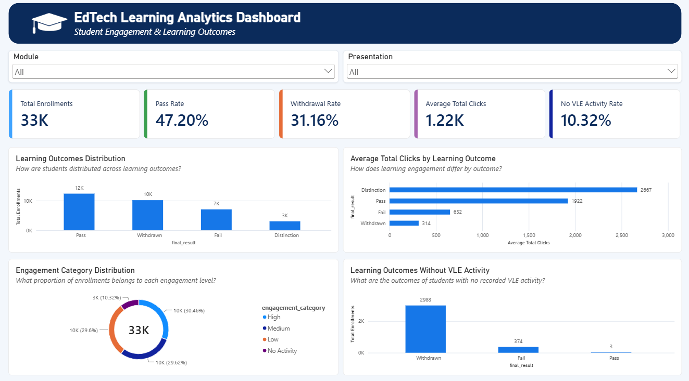

<div align="center">

# EdTech Learning Analytics

### Student Engagement & Academic Performance Analysis

An Educational Data Analytics Project Using the Open University Learning Analytics Dataset (OULAD)

[](https://www.python.org/)
[](https://powerbi.microsoft.com/)
[](https://www.postgresql.org/)
[](https://pandas.pydata.org/)

**Language:** English | [Bahasa Indonesia](README.id.md)

</div>

---

## About the Project

**EdTech Learning Analytics** is a data analytics project that explores the relationship between student engagement in a Virtual Learning Environment (VLE) and academic performance.

Using the **Open University Learning Analytics Dataset (OULAD)**, this project identifies student activity patterns, examines academic performance distributions, and generates insights that can help educational institutions monitor student engagement and identify students who may be at risk of academic difficulties.

## Project Objectives

1. Understand the characteristics and structure of student learning activity datasets.
2. Perform data cleaning and data validation.
3. Analyze student engagement patterns based on VLE activities.
4. Explore the relationship between learning activities and academic performance.
5. Develop an interactive dashboard using Power BI.
6. Generate data-driven insights and business recommendations.

## Dataset

This project uses the **Open University Learning Analytics Dataset (OULAD)**, which contains information about students, learning activities, course registrations, and academic results.

**Dataset Source:** [Open University Learning Analytics Dataset](https://analyse.kmi.open.ac.uk/open_dataset)

### Datasets Used

| Dataset | Description |
|---|---|
| `studentInfo.csv` | Student information and final academic results |
| `studentVle.csv` | Student activity records within the Virtual Learning Environment |
| `studentRegistration.csv` | Student registration and withdrawal information |
| `courses.csv` | Course modules and presentation information |

## Tools & Technologies

| Technology | Purpose |
|---|---|
| Python | Programming language for data processing and analysis |
| Pandas & NumPy | Data manipulation and processing |
| Matplotlib & Seaborn | Data visualization and Exploratory Data Analysis |
| PostgreSQL (Supabase) | Data storage and SQL-based analysis |
| Google Colab | Environment for developing and executing Python notebooks |
| Power BI | Interactive dashboard development |
| Git & GitHub | Version control and project documentation |

## Project Workflow

The project was carried out through the following stages:

1. **Data Understanding**  
   Examining dataset structures, record counts, attributes, and student academic performance distributions.

2. **Data Cleaning**  
   Checking missing values, duplicate records, data type consistency, and data validity.

3. **SQL Analysis**  
   Processing student activity data using PostgreSQL to generate learning engagement metrics.

4. **Exploratory Data Analysis (EDA)**  
   Exploring student activity patterns and academic performance distributions using Python.

5. **Dashboard Preparation**  
   Preparing the final analytical dataset, defining key performance indicators (KPIs), and classifying student engagement levels.

6. **Dashboard Development**  
   Presenting analytical results through an interactive Power BI dashboard.

## Key Performance Indicators (KPIs)

The following indicators were used to evaluate student engagement and academic performance:

| KPI | Value | Description |
|---|---:|---|
| Total Enrollments | 32,593 | Total number of student enrollments |
| Pass Rate | 47.20% | Percentage of students achieving Pass or Distinction |
| Withdrawal Rate | 31.16% | Percentage of students with a Withdrawn result |
| Average Total Clicks | 1,215.14 | Average number of student clicks recorded on the VLE |
| No VLE Activity Rate | 10.32% | Percentage of students without recorded VLE activity |

## Key Findings

The analysis produced several important findings:

1. **Academic Performance Distribution**  
   Student results consisted of 37.93% Pass, 9.28% Distinction, 21.64% Fail, and 31.16% Withdrawn.

2. **Student Engagement and Academic Performance**  
   Students who achieved Distinction had a higher average number of VLE clicks compared to other academic result groups. This indicates an observed relationship between VLE activity and academic performance.

3. **Student Engagement Classification**  
   Students were classified into four engagement categories based on their VLE activity: High, Medium, Low, and No Activity.

4. **Students Without VLE Activity**  
   Among 3,365 students without recorded VLE activity, 2,988 students (88.80%) received a Withdrawn result.

## Business Recommendations

Based on the analytical findings, educational institutions may consider the following actions:

- Monitor student activity on learning platforms regularly.
- Identify students with low engagement levels as an initial step toward providing academic support.
- Develop an early warning system to help detect students who may be at risk of withdrawal.
- Improve academic guidance and learning support for students showing declining engagement.

## Dashboard

An interactive dashboard was developed using **Power BI** to present student academic performance, engagement levels, average VLE clicks, and students without recorded VLE activity.

<div align="center">



*EdTech Learning Analytics – Power BI Dashboard*

</div>

## Analysis Limitations

- The number of VLE clicks does not directly represent the quality of student learning or their understanding of the learning materials.
- The absence of recorded VLE activity does not necessarily mean that students did not participate in other learning activities.
- The length of student engagement periods may influence the number of recorded activities.
- This analysis is descriptive and cannot establish cause-and-effect relationships.

## Repository Structure

```text
edtech-learning-analytics/
│
├── data/
│   ├── raw/
│   └── processed/
│
├── notebooks/
│   ├── 01_data_understanding.ipynb
│   ├── 02_data_cleaning.ipynb
│   ├── 03_sql_analysis.ipynb
│   ├── 04_exploratory_data_analysis.ipynb
│   └── 05_dashboard_preparation.ipynb
│
├── sql/
├── dashboard/
├── images/
├── reports/
│
├── README.md
├── README.id.md
└── .gitignore
