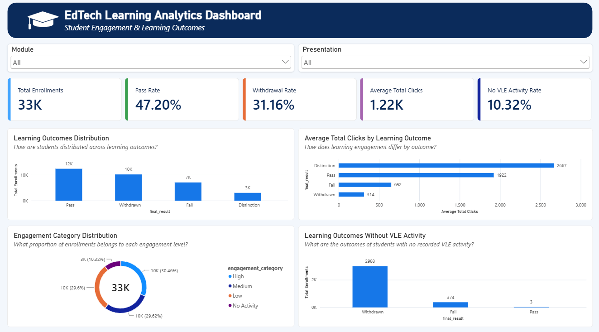

<div align="center">

# EdTech Learning Analytics

### Analisis Keterlibatan dan Hasil Belajar Mahasiswa

Proyek Analisis Data Pendidikan Menggunakan Open University Learning Analytics Dataset (OULAD)

[](https://www.python.org/)
[](https://powerbi.microsoft.com/)
[](https://www.postgresql.org/)
[](https://pandas.pydata.org/)

**Bahasa:** [English](README.md) | Bahasa Indonesia

</div>

---

## Tentang Proyek

**EdTech Learning Analytics** merupakan proyek analisis data yang bertujuan untuk memahami hubungan antara tingkat keterlibatan mahasiswa dalam menggunakan Virtual Learning Environment (VLE) dengan hasil belajar yang diperoleh.

Dengan menggunakan **Open University Learning Analytics Dataset (OULAD)**, proyek ini mengidentifikasi pola aktivitas mahasiswa, menganalisis distribusi hasil belajar, serta menghasilkan wawasan yang dapat membantu institusi pendidikan memantau keterlibatan mahasiswa dan mengidentifikasi mahasiswa yang berpotensi mengalami kesulitan akademik.

## Tujuan Proyek

1. Memahami karakteristik dan struktur dataset aktivitas pembelajaran mahasiswa.
2. Melakukan proses data cleaning dan validasi data.
3. Menganalisis pola keterlibatan mahasiswa berdasarkan aktivitas pada VLE.
4. Mengidentifikasi hubungan antara aktivitas pembelajaran dan hasil belajar mahasiswa.
5. Menyajikan hasil analisis melalui dashboard interaktif menggunakan Power BI.
6. Menghasilkan wawasan dan rekomendasi berbasis data.

## Dataset

Proyek ini menggunakan **Open University Learning Analytics Dataset (OULAD)** yang menyediakan informasi mengenai mahasiswa, aktivitas pembelajaran, pendaftaran mata kuliah, dan hasil belajar.

**Sumber Dataset:** [Open University Learning Analytics Dataset](https://analyse.kmi.open.ac.uk/open_dataset)

### Dataset yang Digunakan

| Dataset | Deskripsi |
|---|---|
| `studentInfo.csv` | Informasi mahasiswa dan hasil akhir pembelajaran |
| `studentVle.csv` | Catatan aktivitas mahasiswa pada Virtual Learning Environment |
| `studentRegistration.csv` | Informasi pendaftaran dan pengunduran diri mahasiswa |
| `courses.csv` | Informasi modul dan periode pembelajaran |

## Tools & Technologies

| Teknologi | Kegunaan |
|---|---|
| Python | Bahasa pemrograman untuk pengolahan dan analisis data |
| Pandas & NumPy | Manipulasi dan pemrosesan data |
| Matplotlib & Seaborn | Visualisasi data dan Exploratory Data Analysis |
| PostgreSQL (Supabase) | Penyimpanan data dan analisis menggunakan SQL |
| Google Colab | Lingkungan pengembangan dan eksekusi notebook Python |
| Power BI | Pembuatan dashboard interaktif |
| Git & GitHub | Version control dan dokumentasi proyek |

## Tahapan Proyek

Proyek ini dilakukan melalui beberapa tahapan berikut:

1. **Data Understanding**  
   Memahami struktur dataset, jumlah data, atribut, serta distribusi hasil belajar mahasiswa.

2. **Data Cleaning**  
   Memeriksa missing values, duplikasi, konsistensi tipe data, dan melakukan validasi data.

3. **SQL Analysis**  
   Mengolah data aktivitas mahasiswa menggunakan PostgreSQL untuk menghasilkan metrik keterlibatan pembelajaran.

4. **Exploratory Data Analysis (EDA)**  
   Menganalisis pola aktivitas mahasiswa dan distribusi hasil belajar menggunakan Python.

5. **Dashboard Preparation**  
   Menyiapkan dataset akhir, menentukan Key Performance Indicators (KPI), dan mengelompokkan tingkat keterlibatan mahasiswa.

6. **Dashboard Development**  
   Menyajikan hasil analisis melalui dashboard interaktif menggunakan Power BI.

## Key Performance Indicators (KPI)

Beberapa indikator utama yang digunakan untuk mengevaluasi keterlibatan dan hasil belajar mahasiswa:

| KPI | Nilai | Deskripsi |
|---|---:|---|
| Total Enrollments | 32.593 | Jumlah total pendaftaran mahasiswa |
| Pass Rate | 47,20% | Persentase mahasiswa dengan hasil Pass atau Distinction |
| Withdrawal Rate | 31,16% | Persentase mahasiswa dengan hasil Withdrawn |
| Average Total Clicks | 1.215,14 | Rata-rata jumlah aktivitas klik mahasiswa pada VLE |
| No VLE Activity Rate | 10,32% | Persentase mahasiswa tanpa catatan aktivitas pada VLE |

## Hasil Analisis dan Temuan Utama

Berdasarkan proses analisis yang dilakukan, diperoleh beberapa temuan utama:

1. **Distribusi Hasil Belajar**  
   Hasil belajar mahasiswa terdiri dari Pass sebesar 37,93%, Distinction sebesar 9,28%, Fail sebesar 21,64%, dan Withdrawn sebesar 31,16%.

2. **Keterlibatan dan Hasil Belajar**  
   Mahasiswa dengan hasil Distinction memiliki rata-rata aktivitas klik lebih tinggi dibandingkan kelompok hasil belajar lainnya. Hal ini menunjukkan adanya pola keterkaitan antara aktivitas pada VLE dan hasil belajar.

3. **Kategori Keterlibatan Mahasiswa**  
   Mahasiswa dikelompokkan menjadi empat kategori berdasarkan jumlah aktivitas pada VLE, yaitu High, Medium, Low, dan No Activity.

4. **Mahasiswa Tanpa Aktivitas VLE**  
   Dari 3.365 mahasiswa yang tidak memiliki catatan aktivitas pada VLE, sebanyak 2.988 mahasiswa atau 88,80% memperoleh hasil Withdrawn.

## Rekomendasi Bisnis

Berdasarkan hasil analisis, institusi pendidikan dapat mempertimbangkan beberapa tindakan berikut:

- Melakukan pemantauan berkala terhadap aktivitas mahasiswa pada platform pembelajaran.
- Mengidentifikasi mahasiswa dengan tingkat keterlibatan rendah sebagai langkah awal pemberian pendampingan akademik.
- Mengembangkan sistem peringatan dini (*early warning system*) untuk membantu mendeteksi mahasiswa yang berpotensi mengundurkan diri.
- Meningkatkan strategi pendampingan dan dukungan pembelajaran bagi mahasiswa yang menunjukkan penurunan aktivitas.

## Dashboard

Dashboard interaktif dikembangkan menggunakan **Power BI** untuk menyajikan informasi mengenai hasil belajar, tingkat keterlibatan, rata-rata aktivitas klik, dan mahasiswa tanpa aktivitas VLE.

<div align="center">



*EdTech Learning Analytics – Power BI Dashboard*

</div>

## Batasan Analisis

- Jumlah klik pada VLE tidak secara langsung menggambarkan kualitas pembelajaran atau tingkat pemahaman mahasiswa terhadap materi.
- Tidak adanya catatan aktivitas pada VLE tidak selalu berarti mahasiswa tidak melakukan kegiatan belajar.
- Lama periode keterlibatan mahasiswa dapat memengaruhi jumlah aktivitas yang tercatat.
- Analisis ini bersifat deskriptif sehingga tidak dapat digunakan untuk menyimpulkan hubungan sebab-akibat.

## Struktur Repository

```text
edtech-learning-analytics/
│
├── data/
│   ├── raw/
│   └── processed/
│
├── notebooks/
│   ├── 01_data_understanding.ipynb
│   ├── 02_data_cleaning.ipynb
│   ├── 03_sql_analysis.ipynb
│   ├── 04_exploratory_data_analysis.ipynb
│   └── 05_dashboard_preparation.ipynb
│
├── sql/
├── dashboard/
├── images/
├── reports/
│
├── README.md
├── README.id.md
└── .gitignore
